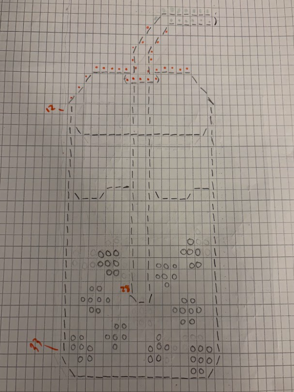

# scroll-art

## ASCII Artwork

For this project, I chose to make 3 different ASCII arts of things that I thought would be interesting to make as icons or, in general, singular objects that can be repeated many times. More specifically, I chose to create a bubble tea cup, a penguin (outline), and Miffy. I didn't really get any inspiration from outside sources or ASCII art made by other people, as my only reference for these creations were the original Google search images of these objects/things, and I also drew each one on graph paper myself.

### Process 
For each artwork, I first drew it out, mostly utilizing slashes, the | symbol, and underscores to create the shape. Sometimes I used @ to color in a few parts. Then, I created a box on the graph paper to represent where I wanted the overall array to go, and also to figure out the dimensions. Then I transferred everything into Java, often using for loops when there was a repeated pattern or element in the drawing I did on paper. 

Here are some sketches I made:

#### Citations

I used some of Ms. Feng's code in order to print the 3 artworks, but the 3 methods GetBoba, GetPenguin, and GetMiffy I made by myself.

(Citation Points: 1)

