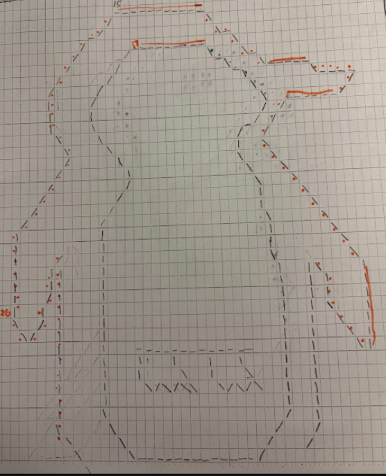
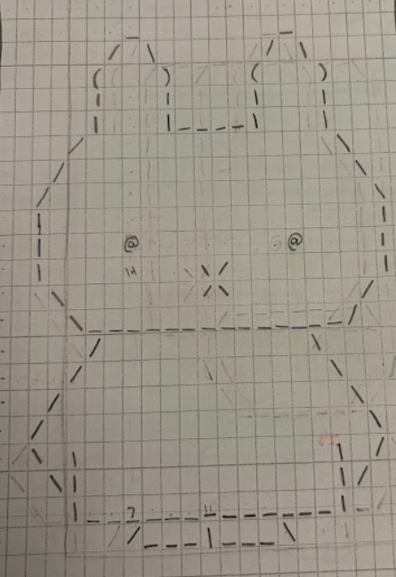

# scroll-art

## ASCII Artwork

For this project, I chose to make 3 different ASCII arts of things that I thought would be interesting to make as icons or, in general, singular objects that can be repeated many times. More specifically, I chose to create a bubble tea cup, a penguin (outline), and Miffy. I didn't really get any inspiration from outside sources or ASCII art made by other people, as my only reference for these creations were the original Google search images of these objects/things, and I also drew each one on graph paper myself.

Art.java is a java program that prints 3 of my own ASCII artworks, and now in addition also displays the work of 3 other students. 

### Process 
For each artwork, I first drew it out on ASCII art graph paper, mostly utilizing slashes, the | symbol, and underscores to create the shape. I also used the @ to color in a few parts. Then, I created a box on the graph paper to represent where I wanted the overall array to go, and also to figure out the numbers of rows and columns in the array. Then I transferred everything into Java, often using for loops when there was a repeated pattern or element in the drawing I did on paper. 

Here are some sketches I made:

#### Citations

I referenced ifenghm's (Ms. Feng's) ScrollArtV1, ScrollArtV2, and ScrollArtWithClasses to write the code that allowed the images to scroll and print row-by-row as they appeared, but the methods getBoba(), getPenguin(), and getMiffy() I wrote and created myself. When I incorporated 3 other students' art into my "gallery" to practice using classes with the AsciiArt class, I included carolinek7's (Caroline's) Totoro art, samif's (Samira's) fish art, and ewang821's (Emma's) pumpkin art. More specifically, the methods in the code called getTotoro(), getBigFish(), and pumpkin() are from their respective projects.

(Citation Points: 1)

